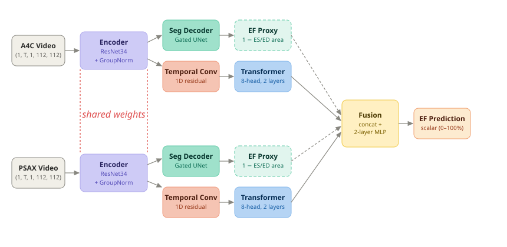
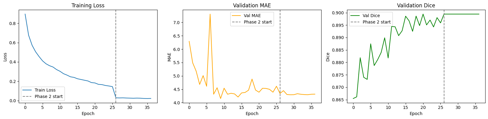
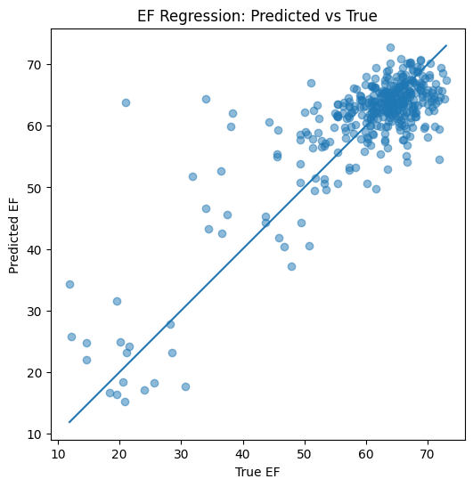
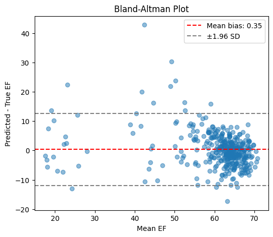
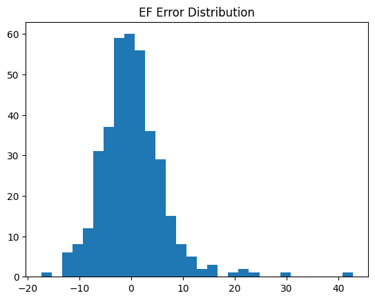

# Dual-View Ejection Fraction Prediction


A deep learning model that segments the left ventricle and predicts ejection fraction (EF) from pediatric echocardiogram videos, served through a REST API. It takes an apical 4-chamber (A4C) and a parasternal short-axis (PSAX) video from the same visit and returns the EF as a percentage. A web frontend that uses this API is in progress.

## Overview

EF measures how much blood the left ventricle pumps out with each heartbeat. A clinician normally estimates it by tracing the ventricle by hand at its fullest moment (end-diastole, ED) and its most contracted moment (end-systole, ES). This model does both steps automatically. It segments the ventricle in every frame, uses the change in its area to find ED and ES, cuts a one-second clip around them, and predicts EF from the A4C and PSAX clips together. Every video is first resampled to 32 FPS, so a clip covers the same span of time whatever the recording's frame rate.

The model was trained on the [EchoNet-Pediatric](https://echonet.github.io/pediatric/) dataset in two phases: first segmentation and EF jointly, then EF alone with the segmentation frozen. Inference needs no annotations. The same predictor powers a command-line tool and a FastAPI server, which loads the model once at startup and accepts video uploads over HTTP.

## Architecture



- **Shared encoder:** a `ResNet34` with GroupNorm processes every frame of both views.
- **Segmentation:** a gated `UNet` decoder predicts a left ventricle mask for each frame.
- **Temporal features:** a 1D residual convolution captures motion between neighbouring frames, and a transformer summarises the whole clip.
- **EF head:** both views' features and a mask-area EF estimate per view are concatenated and passed through a 2-layer MLP (514 → 128 → 1).

## Results

Measured on the 351 A4C + PSAX test pairs. "Annotated clips" uses the dataset's traced ED/ES frames; "raw videos" is the full inference pipeline, which finds ED/ES itself.

| Metric | Annotated clips | Raw videos |
| --- | --- | --- |
| MAE (EF %) | 4.09 | 4.17 |
| RMSE (EF %) | 5.61 | 5.90 |
| R² | 0.738 | 0.709 |
| Within ±5 EF % | 70.1% | 71.2% |
| AUC (EF < 50%) | 0.961 | 0.948 |

Raw-video inference had no failures and took about 72 ms per pair on a GPU.

<p><em>Training loss and validation metrics across both phases</em></p>



<p><em>Predicted vs actual EF on the test set</em></p>



<p><em>Agreement between predicted and actual EF</em></p>



<p><em>Distribution of prediction errors</em></p>



## Features

- **EF prediction**
  - Predicts EF from a raw A4C + PSAX video pair, with no manual tracing
  - Detects ED and ES automatically from the predicted ventricle area
  - Uses one heartbeat per view; averaging over several beats is planned

- **Serving**
  - REST API with `GET /health` and `POST /predict`, plus interactive docs at `/docs`
  - Command-line tool with optional JSON output
  - Clear errors: 400 for unreadable videos, 413 for oversized uploads, 422 for missing files

- **Training and evaluation**
  - Two-phase training with early stopping on validation Dice, then validation MAE
  - Test script that reports metrics and saves the scatter, ROC, Bland-Altman and segmentation plots

## Tech Stack

- **Model:** PyTorch and torchvision (ResNet34 encoder)
- **Video and data:** OpenCV for decoding, NumPy and pandas
- **Evaluation:** scikit-learn metrics and matplotlib plots
- **API:** FastAPI on uvicorn, configured through environment variables, with checkpoints from a local path or S3
- **Testing:** pytest with FastAPI's `TestClient`
- **CI/CD:** GitHub Actions runs the tests on every push and on pull requests to `main`

## Project Structure

```
.
├── .github/workflows/   # CI: runs pytest on pushes and pull requests
├── api/                 # FastAPI server, upload and checkpoint helpers
├── assets/              # Architecture diagram
├── cli/                 # Command-line arguments for training, testing and inference
├── data/                # Dataset loading, frame extraction, clips and masks
├── evaluation/          # Test script, metrics, plots and segmentation videos
├── inference/           # EchoPredictor, ED/ES detection and the predict CLI
├── models/              # Encoder, decoder, temporal layers and the full model
├── notebooks/           # Data exploration
├── results/             # Plots shown in this README
├── tests/               # API tests
└── training/            # Two-phase training loop and losses
```

## Getting Started

### Prerequisites

- Python 3.10
- An NVIDIA GPU with CUDA for training (inference and the API also run on CPU)
- Access to the [EchoNet-Pediatric](https://echonet.github.io/pediatric/) dataset, which requires agreeing to its usage terms. The dataset folder should contain `A4C/` and `PSAX/`, each with `FileList.csv`, `VolumeTracings.csv` and `Videos/`

### Installation

```bash
pip install -r requirements-dev.txt
```

On a machine without a GPU, install the much smaller CPU build of PyTorch first:

```bash
pip install torch==2.5.1 torchvision==0.20.1 --index-url https://download.pytorch.org/whl/cpu
pip install -r requirements-dev.txt
```

A server only needs `requirements.txt`; `requirements-dev.txt` adds the test tools.

### Local Development

Train the model (checkpoints are saved to `checkpoints/`), then evaluate it on the test split:

```bash
python3 -m training.train --dataset-root path/to/dataset --processed-root path/to/processed
python3 -m evaluation.test --dataset-root path/to/dataset --processed-root path/to/processed \
    --checkpoint checkpoints/best_model_mae.pth
```

Predict EF for one video pair:

```bash
python3 -m inference.predict --a4c path/to/a4c.avi --psax path/to/psax.avi --output result.json
```

Run the API. Its settings come from environment variables, here from a gitignored `.env.local`:

```bash
ECHO_CHECKPOINT=checkpoints/best_model_mae.pth   # required: a local path or s3://bucket/key
ECHO_CORS_ORIGINS=http://localhost:5173          # optional: comma-separated frontend origins
ECHO_DEVICE=cpu                                  # optional: defaults to cuda when available
ECHO_MAX_UPLOAD_MB=50                            # optional: per-file upload limit, default 50
```

```bash
uvicorn api.main:app --reload --env-file .env.local
curl -X POST http://127.0.0.1:8000/predict -F "a4c=@path/to/a4c.avi" -F "psax=@path/to/psax.avi"
```

### Running Tests

```bash
python3 -m pytest tests/ -v
```

When the real checkpoint isn't present, the tests use one with random weights, so they also run on a fresh checkout and in CI.

## Deployment

Not deployed yet, AWS planned.

## Dataset

This project uses the [EchoNet-Pediatric](https://echonet.github.io/pediatric/) dataset. Access requires agreeing to its usage terms, so no videos or annotations are included in this repository.

Thank you to Stanford University and the EchoNet team for making this dataset available for research.

> **Disclaimer:** This project is for research use only. It has not been reviewed or approved by the FDA, and its predictions must not be used for clinical diagnosis or patient care.

## License

_TBD_

## Contact

Ricardo Vazquez - [ricardo.vazquez2001@gmail.com](mailto:ricardo.vazquez2001@gmail.com)

## Related Repositories

- **Frontend** (in progress): a web app for uploading the two videos and viewing the predicted EF.
